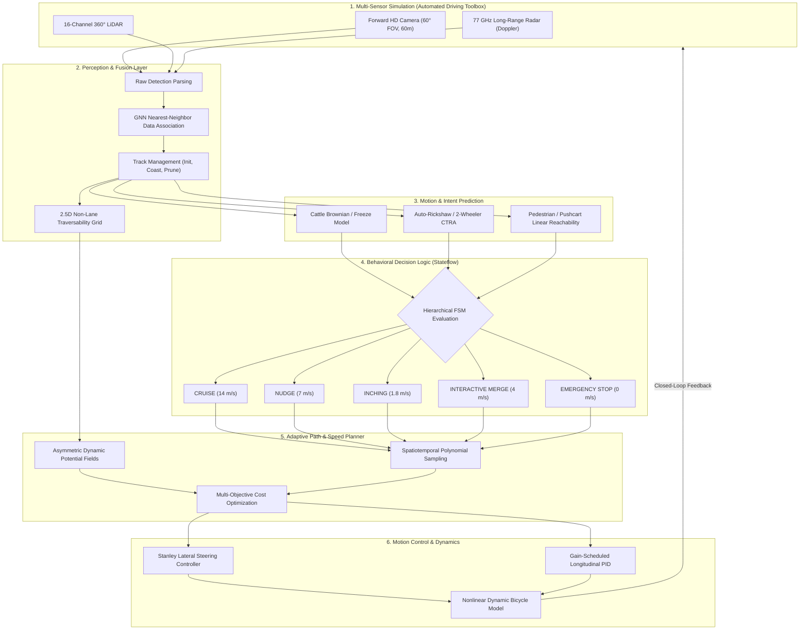
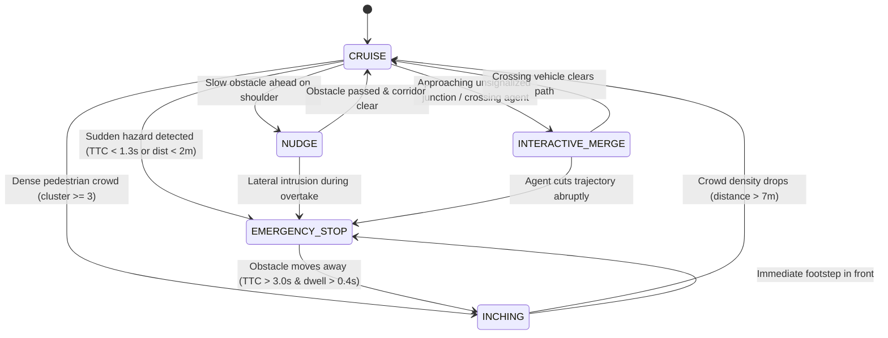
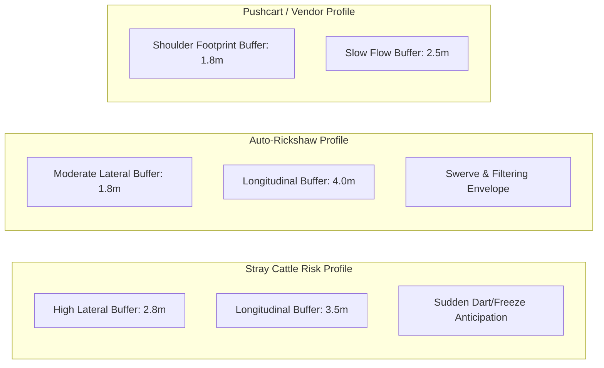

# Architecture Diagrams: SIH-26037
## Adaptive Path Planning and Collision Avoidance on Unstructured Indian Roads

---

### 1. End-to-End System Pipeline

---

### 2. Behavioral Stateflow FSM Transitions

---

### 3. Asymmetric Potential Risk Field Contours

